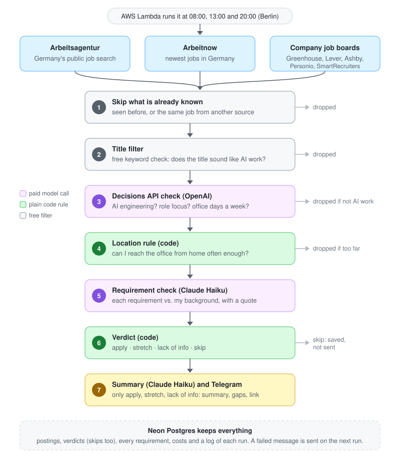

# job-fit-workflow

Every day, this pipeline reads new job postings in Germany, checks each one against my background and sends the good ones to my phone on Telegram. Each message says **apply**, **stretch** or **lack of info**, lists the gaps and links to the posting.

It is a fixed workflow, not an agent. So the steps always run in the same order, and the final verdict is
decided by plain code, not by the model.



## How it works

1. **Collect.** New postings come from the Arbeitsagentur API, Arbeitnow and the job boards of a list of companies.
2. **Skip what is known.** A posting already in the database, or the same job from another source, is dropped.
3. **Title filter.** A free keyword check drops titles that are clearly not AI work (sales, marketing and so on).
4. **Decisions API check.** One decisions API call answers two questions: is this hands-on AI engineering, and how many days a week is the office required?
5. **Location rule.** Code decides whether the office is close enough for that many days. Too far means skip, and unsure means "check it yourself".
6. **Requirement check.** Claude Haiku goes through the posting requirement by requirement and compares each one with my background. Every "I have this" must come with a quote from the background, and code checks that the quote is really there.
7. **Verdict.** Code counts the gaps and decides (see the table below).
8. **Telegram.** Every posting that is not a skip gets a short message. A morning and an evening message report on the runs themselves.

Everything is saved in Postgres (postings, verdicts, every requirement, costs and a log of each run). So if a
message fails, it is sent again on the next run.

## The verdict rules

Only **critical** requirements count. A partial language level (for example German B1 where B2 is asked for) never counts on its own.

| Verdict | When |
| --- | --- |
| skip | the office is too far, a must-have eligibility is missing, 2 skills are missing, more than 2 are only partly met, or 1 is missing and 2 are partly met |
| lack of info | the office distance needs a manual check, or the posting asks for something my background does not mention |
| stretch | 1 skill missing, 2 partly met, or an eligibility only partly met (for example a start date) |
| apply | none of the above |

## Run it yourself

You need Python 3.14, a Postgres database (I use [Neon](https://neon.tech), the free plan is enough) and these keys:

| Key | For |
| --- | --- |
| `ANTHROPIC_API_KEY` | the requirement check and the summaries (Claude Haiku) |
| `OPENAI_API_KEY` | the decisions API check |
| `DATABASE_URL` | your Postgres connection string |
| `GEOAPIFY_API_KEY` | turning city names into coordinates ([Geoapify](https://www.geoapify.com), free plan) |
| `TELEGRAM_BOT_TOKEN`, `TELEGRAM_CHAT_ID` | your bot from [@BotFather](https://t.me/BotFather) and your chat with it |

```
python -m venv .venv
.venv\Scripts\activate            (on Mac or Linux: source .venv/bin/activate)
pip install -r requirements.txt
copy .env.example .env             (then fill in your keys)
```

Then:

1. **Create the tables.** Run `db/schema.sql` once in your database.
2. **Write your background.** Copy `data/background.example.txt` to `data/background.txt` and describe yourself in the same sections. This file stays out of Git.
3. **Set your home.** Change `HOME` and the state lists in `job_fit/code_nodes/location.py` (they are set for Münchberg in Bavaria).
4. **Choose what to search.** `SEARCH_TERMS` in `job_fit/sources/arbeitsagentur.py`, and the companies in `WATCH_LIST` in `job_fit/sources/company_feeds.py`.
5. **Run it once.**

```
python -m scripts.run_daily --days 1 --max 3      # at most 3 Haiku checks, to test cheaply
python -m scripts.run_daily --no-telegram         # everything except the messages
```

### Run it every day on AWS Lambda

```
python -m scripts.build_lambda       # builds lambda.zip for Lambda's Linux
```

1. Create a Lambda function with the Python 3.14 runtime, 512 MB memory and a 15 minute timeout (a run takes about 5 minutes).
2. Upload `lambda.zip` (Code > Upload from > .zip file) and add the keys above as environment variables.
3. Add an EventBridge schedule for each run time, with the event `{"days": 1}`.

## Cost

In my use it costs a few cents to about 35 cents a day, almost all of it Claude Haiku. The exact cost of every
call is saved in the `model_verdicts` table.

## Project layout

| Path | What it is |
| --- | --- |
| `scripts/run_daily.py` | the whole daily run, step by step |
| `lambda_function.py` | the entry point AWS Lambda calls |
| `job_fit/sources/` | one file per job source |
| `job_fit/code_nodes/` | the free rules: duplicates, title filter, location, verdict |
| `job_fit/llm/` | the model calls, the prompt and the answer schema |
| `job_fit/bot/telegram.py` | the messages and the error alerts |
| `job_fit/db.py` | every database query |
| `db/schema.sql` | the tables |
| `scripts/compare_models.py` | how the model was chosen ([history](docs/model-comparison.md)) |

## Credits

Job data from the [Arbeitsagentur Jobsuche API](https://jobsuche.api.bund.dev) and [Arbeitnow](https://www.arbeitnow.com).
Geocoding powered by [Geoapify](https://www.geoapify.com), © [OpenStreetMap](https://www.openstreetmap.org/copyright) contributors.

## License

[MIT](LICENSE)
